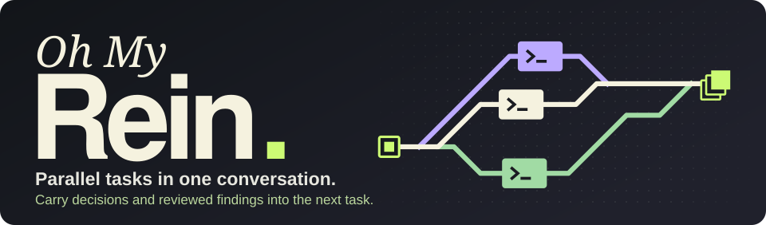
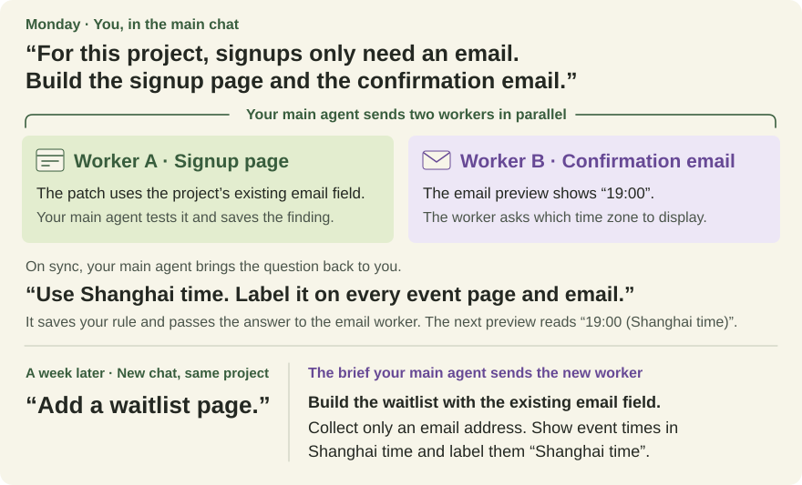
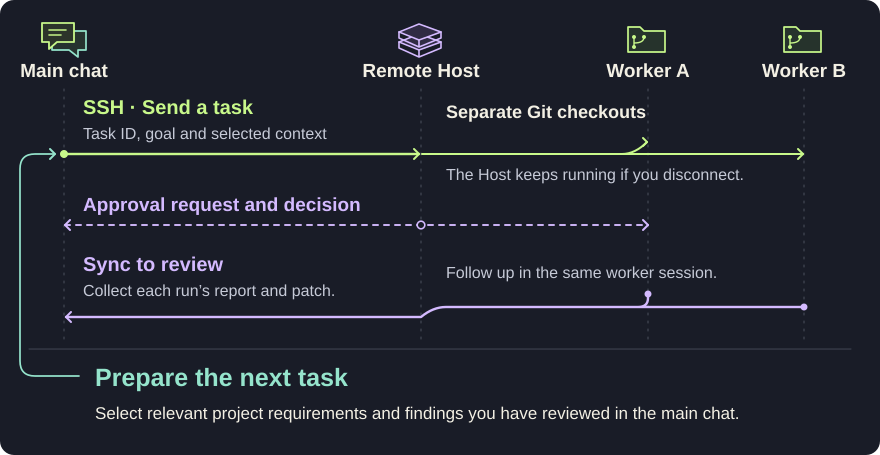

<p align="center">
  <picture>
    <source media="(max-width: 640px)" srcset="assets/hero-mobile.svg" />
    
  </picture>
</p>

<p align="center">
  <a href="#how-it-works">Workflow</a> ·
  <a href="#try-the-demo">Demo</a> ·
  <a href="INSTALL.md">Install</a> ·
  <a href="#support">Support</a> ·
  <a href="README.zh-CN.md" lang="zh-CN">简体中文</a>
</p>

With **Oh My Rein**, you give one main agent your tasks and project requirements. It delegates to workers that run in parallel on your SSH host. When you sync, it reviews each result and brings open questions back to you. Your answers and the findings it checks can become part of the project context it draws on for future work.

## A week later, you just ask for a waitlist

Imagine you’re launching an event site. You talk to your main agent while two remote workers build the signup page and the confirmation email in parallel.

<a href="assets/context-loop.svg">
  <picture>
    <source media="(max-width: 640px)" srcset="assets/context-loop-mobile.svg" />
    
  </picture>
</a>

**What does the main agent keep?** Email-only signup comes from your first request. Labeling Shanghai time comes from your reply to the email preview. The main agent saves both agreements in Rein’s local SQLite store with your words, their scope and their versions. It also keeps the reusable email field as a project finding, linked to the signup run and the check it performed.

A week later, enable Rein in a new chat in the same project and harness. Your main agent can select those three shareable records for the waitlist brief.

## How it works

<a href="assets/architecture.svg">
  <picture>
    <source media="(max-width: 640px)" srcset="assets/architecture-mobile.svg" />
    
  </picture>
</a>

- **When you reconnect**, return to the original chat and ask “Sync my Rein tasks.” Review each task separately or follow up in one worker’s native session.
- **When a worker needs permission**, the default `ask` route brings the decision to you. With `delegate`, your main agent can decide. Tool and sandbox permissions are configured separately. [Permission settings](docs/operations.md#permission-requests)
- **When you accept a result**, you decide whether to apply its patch. Your main agent can retain a finding with its source for future tasks.

## Try the demo

From a Rein source checkout with Node.js **24.x**, npm and Git:

```sh
npm ci --ignore-scripts
npm run demo
```

Two sample workers run locally without SSH or a model key. Watch the client disconnect, reconnect and collect two patches. Then open `next-task.json` in the printed results directory to see which reviewed finding the next task received.

## Get started

For remote work, prepare Node.js **24.x**, npm, Git and the chosen harness CLI on both machines. SSH must connect without a prompt, the remote worker needs model access, and both project checkouts must contain the task's base commit.

**Install the beta from npm.**

```sh
npm install -g oh-my-rein@beta
```

You can also [build and install the archive from source](INSTALL.md#build-from-source).

**Connect your harness.** In your local terminal, choose the harness you chat with and the worker you want on the SSH host. For Claude Code locally and Codex remotely, run:

```sh
rein setup --harness claude --worker codex
```

For Pi locally, change `--harness claude` to `--harness pi`. For Codex on both ends, `rein setup` uses those defaults. Follow the prompts, then reopen the project in your local harness. The conversation controls below work with any configured worker type.

| Your local conversation | Turn on | Turn off | Check workers | Sync once |
| --- | --- | --- | --- | --- |
| Claude Code | `/rein:on` | `/rein:off` | `/rein:status` | `/rein:sync` |
| Codex CLI | `$rein:rein on` | `$rein:rein off` | `$rein:rein status` | `$rein:rein sync` |
| Pi | `/rein on` | `/rein off` | `/rein status` | `/rein sync` |

Once the Host is connected, give your main agent a task. **Check workers** shows the last known executions grouped by task, even after turning Rein off. **Sync once** contacts the Host for updates and can deliver pending work or approval decisions. You can also say **“Sync my Rein tasks.”** [Installation and troubleshooting](INSTALL.md)

## Support

| Integration | Verified in the development preview |
| --- | --- |
| Claude Code main → SSH Codex | Concurrent tasks, task corrections, reconnect, and human deny/allow in one native worker session |
| Codex main and workers | CLI workflow, with Codex worker concurrency and reconnect over SSH |
| Claude Code workers | Local Host with a real model and scripted approvals. Remote installation and remote approvals pending. |
| Pi main and workers | Native CLI and local Host with a real model. Remote installation and remote approvals pending. |

<details>
<summary><strong>Preview limits and validation</strong></summary>

- Each ledger connects one project to one Host. Task control stays with the originating conversation. Reviewed project context can be selected in a new one.
- Claude Code and Codex sync on request. Pi also syncs before the next turn with Rein enabled. Automatic wake-up and live steering of a running worker are pending.
- Workers start from a committed base. Local uncommitted edits are excluded. A separate checkout provides workspace separation, not OS-level isolation. Native memory writeback and full memory isolation are unverified.
- Client reconnect has been tested. Recovery from a full network partition or machine reboot, fresh OS installation, and desktop UI still need validation.

The acceptance record includes the beta archive checksum and the exact file and patch checks for a human denial followed by an allowance. [Read the validation record](https://github.com/rein-extension/oh-my-rein/blob/main/docs/validation.md).

</details>

## Development

From the source checkout, after `npm ci --ignore-scripts`:

```sh
npm run check        # Type-check
npm test             # Deterministic suite, no model calls
npm run check:package
```

Live tests use model credits. See the [installation guide](INSTALL.md) for setup and the [contributing guide](https://github.com/rein-extension/oh-my-rein/blob/main/CONTRIBUTING.md) for development checks.

---

Rein draws on the [DSH Superagent prototype](https://github.com/deepseek-ai/dsh-superagent-prototype) for task/execution separation, durable delivery and recovery.
