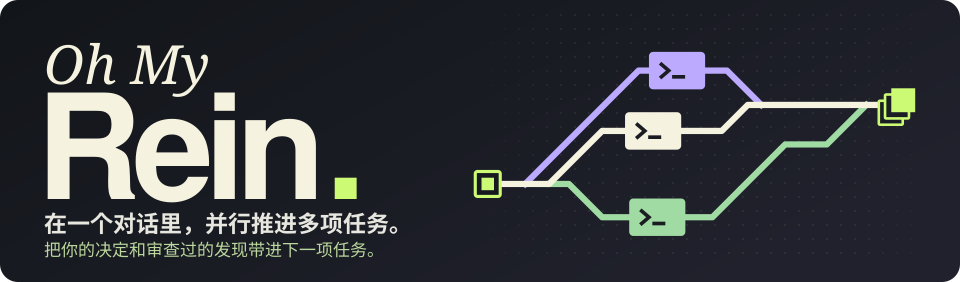
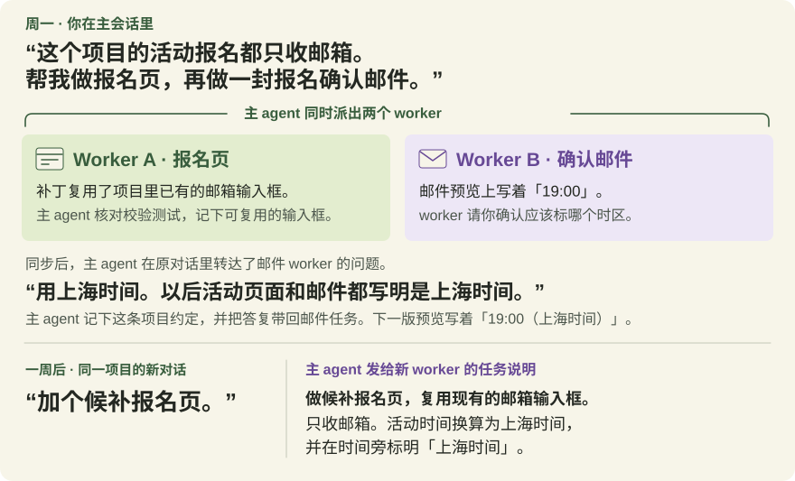
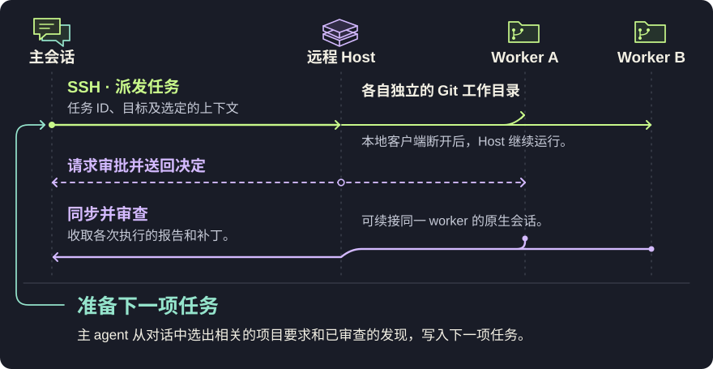

<p align="center">
  <picture>
    <source media="(max-width: 640px)" srcset="assets/hero-mobile-zh.svg" />
    
  </picture>
</p>

<p align="center">
  <a href="#工作方式">流程</a> ·
  <a href="#本地体验">体验</a> ·
  <a href="INSTALL.zh-CN.md">安装</a> ·
  <a href="#支持状态">支持</a> ·
  <a href="README.md" lang="en">English</a>
</p>

用 **Oh My Rein**，你在一个主会话里交代任务和项目约定。主 agent 通过 SSH 派多个 worker 并行干活，同步时逐项核对结果，把需要你决定的问题带回对话。你的答复和经核实的发现都可以留在项目里，供后续派工时选用。

## 一周后，你只说「加个候补报名页」

以一个活动网站为例。你始终只跟主 agent 聊，报名页和确认邮件由两个远程 worker 同时做。

<a href="assets/context-loop-zh.svg">
  <picture>
    <source media="(max-width: 640px)" srcset="assets/context-loop-mobile-zh.svg" />
    
  </picture>
</a>

**主 agent 留下了什么？** 「报名只收邮箱」来自你最初的要求。「活动时间要标明上海时间」来自你看过邮件预览后的答复。主 agent 把这两条项目约定存入本地 SQLite，保留你的原话、适用范围和版本。报名页 worker 发现的可复用输入框则是一条项目事实，带着来源任务和主 agent 的核对记录。

一周后，在同一项目、同一 harness 的新对话里启用 Rein，主 agent 就能选出这三条可共享的上下文，写进候补页的任务说明。

## 工作方式

<a href="assets/architecture-zh.svg">
  <picture>
    <source media="(max-width: 640px)" srcset="assets/architecture-mobile-zh.svg" />
    
  </picture>
</a>

- **重新连上后**，回到原对话，说「同步一下 Rein 任务」。可以分别查看各项任务，也可以继续和其中一个 worker 的原生会话交互。
- **worker 请求权限时**，默认的 `ask` 让你决定，`delegate` 允许主 agent 决定。工具和沙箱权限可单独配置。[权限设置](docs/operations.zh-CN.md#权限请求)
- **验收结果时**，你决定是否应用补丁。主 agent 可以为后续任务保留一条发现及其出处。

## 本地体验

在 Rein 源码目录中，使用 Node.js **24.x**、npm 和 Git 运行：

```sh
npm ci --ignore-scripts
npm run demo
```

两个示例 worker 在本地并行运行，无需 SSH 或模型密钥。你会看到客户端断开、重连并收回两份补丁。打开输出目录中的 `next-task.json`，可以直接看到下一项任务拿到了哪条审查过的发现。

## 开始使用

使用远程 worker 前，在两台机器上准备 Node.js **24.x**、npm、Git 和各自使用的 harness CLI。确保 SSH 可非交互连接、远程 worker 已配置模型访问，并且两份项目仓库都含有任务的基线提交。

**从 npm 安装 beta 版。**

```sh
npm install -g oh-my-rein@beta
```

也可以[从源码打包安装](INSTALL.zh-CN.md#从源码打包)。

**连接主 agent。** 在本地终端选好两端：`--harness` 是你平时聊天用的工具，`--worker` 是 SSH 主机上执行任务的工具。例如，本地用 Claude Code、远程用 Codex：

```sh
rein setup --harness claude --worker codex
```

本地用 Pi，把 `--harness claude` 换成 `--harness pi`；两端都用 Codex，直接运行 `rein setup`。按提示完成安装，再用本地 harness 重新打开项目。无论选哪种远程 worker，都按本地主会话这一行操作。

| 本地主会话 | 开启 | 关闭 | 查看 worker | 同步一次 |
| --- | --- | --- | --- | --- |
| Claude Code | `/rein:on` | `/rein:off` | `/rein:status` | `/rein:sync` |
| Codex CLI | `$rein:rein on` | `$rein:rein off` | `$rein:rein status` | `$rein:rein sync` |
| Pi | `/rein on` | `/rein off` | `/rein status` | `/rein sync` |

看到 Host 已连接，就可以直接跟主 agent 说任务。**查看 worker** 会按任务列出各次执行的最近已知状态，关闭 Rein 后也能查。**同步一次** 会联系 Host 收取进展，也可能送达排队的任务或已有的审批决定。你也可以直接说 **“同步一下 Rein 任务”**。[安装与排错](INSTALL.zh-CN.md)

## 支持状态

| 接入方式 | 开发预览版已验证范围 |
| --- | --- |
| Claude Code 主 agent → SSH Codex | 并行任务、纠正要求、重连，以及同一原生 worker 会话内由用户先拒绝、再允许一次 |
| Codex 主 agent 和 worker | CLI 工作流，以及 SSH Codex worker 并发与重连 |
| Claude Code worker | 本地 Host 的真实模型执行与脚本审批。远程安装和远程审批待验收。 |
| Pi 主 agent 和 worker | 原生 CLI 和本地 Host 的真实模型执行。远程安装和远程审批待验收。 |

<details>
<summary><strong>预览版限制与验收记录</strong></summary>

- 每个账本连接一个项目和一个 Host。原会话保有任务控制权，新会话可选用已审查的项目上下文。
- Claude Code 和 Codex 按需同步。Pi 启用 Rein 后，也会在下一轮开始前同步。自动唤醒和运行中 worker 的实时指令更新仍待实现。
- worker 从已提交的基线开始，本地未提交的改动不随任务传输。独立工作目录只隔离工作区，不能提供操作系统级隔离。原生记忆写回和完整记忆隔离仍待验证。
- 已验证客户端重连。完整网络分区、机器重启、全新系统安装及桌面 UI 仍待验收。

验收记录列出了安装包校验值，也记录了人工拒绝和允许写入后，如何核对文件和补丁。[查看验证记录](https://github.com/rein-extension/oh-my-rein/blob/main/docs/validation.md)。

</details>

## 开发

在源码目录运行 `npm ci --ignore-scripts` 后，可以执行：

```sh
npm run check        # 类型检查
npm test             # 确定性测试，不调用模型
npm run check:package
```

真实模型测试会消耗服务商额度。环境准备见[安装指南](INSTALL.zh-CN.md)，开发检查见[贡献指南](https://github.com/rein-extension/oh-my-rein/blob/main/CONTRIBUTING.md)。

---

Rein 的任务与执行分离、持久化投递及恢复设计受到 [DSH Superagent 原型](https://github.com/deepseek-ai/dsh-superagent-prototype)启发。
